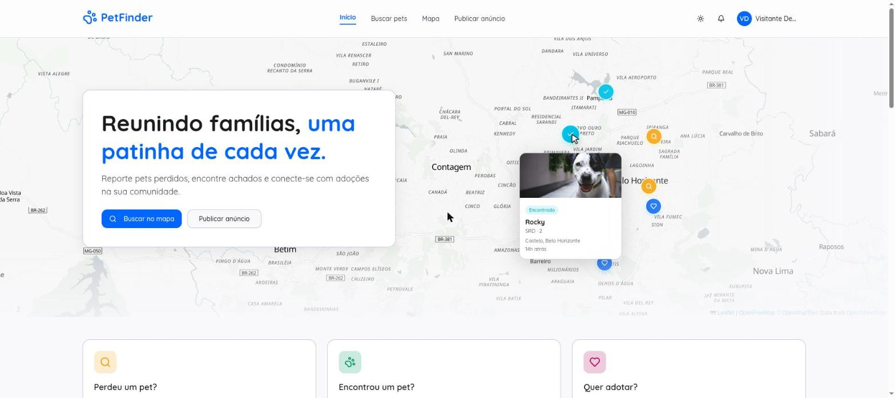
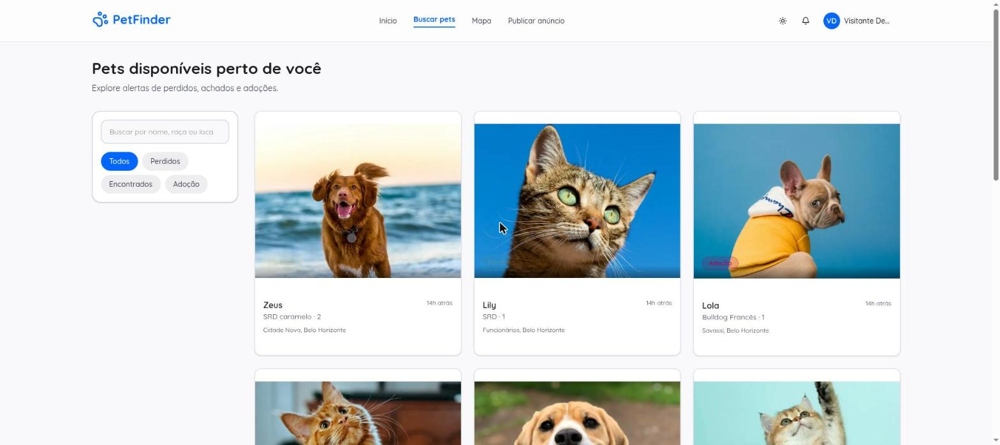
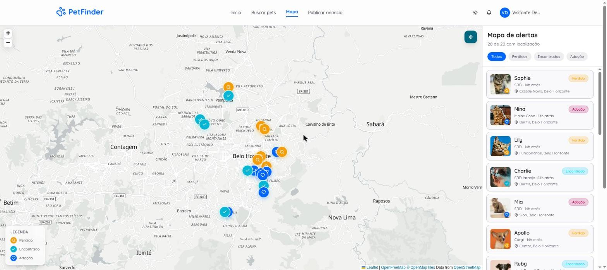

# PetFinder

[](https://github.com/henriquemalvar/petfinder/actions/workflows/ci.yml)

Plataforma para reunir pets perdidos com as famílias, divulgar animais encontrados e conectar adoções, com mapa da região e alertas da comunidade. A vitrine está em Belo Horizonte.

**No ar:** https://petfinder-web-kappa.vercel.app

Para explorar sem criar conta, use o botão **Entrar como visitante demo** na tela de login. A documentação da API fica em https://petfinder-api-alpha.vercel.app/api-docs.



| Buscar pets | Mapa de alertas |
|---|---|
|  |  |

## Funcionalidades

- Anúncios de pet perdido, encontrado e para adoção, com wizard de publicação em 5 passos e foto
- Mapa com os alertas por tipo, filtros e lista lateral
- Busca por nome, raça ou local
- Contato pelo WhatsApp ou Instagram, conforme a preferência de quem anunciou
- Notificações dentro do app, comentários nos anúncios, edição, exclusão e marcação como resolvido
- Login com e-mail e senha ou com Google, troca de senha e exclusão de conta
- Tema claro e escuro, inclusive no mapa

## Stack

| Camada | Tecnologias |
|---|---|
| Web | Next.js 15, React 19, Tailwind CSS 4, shadcn/ui, Leaflet com MapLibre e OpenFreeMap |
| API | Node.js 22, Express 5, Prisma 6, PostgreSQL, Zod, JWT, Swagger |
| Testes | Vitest, Supertest com Postgres real, Cypress |
| Infra | Vercel com funções em São Paulo, Neon Postgres, Cloudinary, GitHub Actions |

## Arquitetura

```
navegador ──► Next.js (petfinder-web) ──► Express (petfinder-api) ──► Postgres (Neon)
                │  rotas /api/* fazem proxy        │
                │  e guardam o JWT em cookie       └── Cloudinary (fotos)
                │  httpOnly
                └── mapa: tiles vetoriais do OpenFreeMap
```

Monorepo com npm workspaces: `apps/web`, `apps/api` e `packages/tokens`.

## Decisões técnicas

- **Sessão fora do alcance de scripts.** O navegador nunca vê o token. As rotas do Next recebem login e cadastro, chamam a API pelo servidor e gravam o JWT num cookie httpOnly.
- **Rate limit por visitante, não por servidor.** Como o login passa pelo servidor do Next, a API enxergaria todo mundo com o mesmo IP. O web repassa o IP que a Vercel grava em `x-vercel-forwarded-for`, assinado com um segredo compartilhado, e a API só confia nesse IP quando o segredo confere.
- **Conta demo que não quebra.** A conta pública não consegue trocar e-mail, senha nem ser excluída, e não é dona do conteúdo da vitrine, então um visitante não derruba a demo para o próximo.
- **Proteção contra IDOR testada ponta a ponta.** Editar ou excluir recurso de outro usuário é bloqueado na API e coberto por testes de integração e pelo Cypress.
- **Fotos de celular dentro do limite.** As funções da Vercel recusam requisições acima de 4,5 MB, então o navegador reduz a foto antes do upload.
- **Mapa sem chave.** Os tiles vêm do OpenFreeMap, sem cadastro nem limite de uso.

## Testes e CI

O GitHub Actions roda três jobs a cada PR:

- **api:** lint, typecheck do código e dos testes, testes unitários e testes de integração contra um Postgres de verdade
- **web:** lint, typecheck, testes unitários e build
- **e2e:** sobe API e web com banco populado e roda o Cypress, cobrindo login, autorização e as telas principais

## Rodando localmente

Pré-requisitos: Node.js 22 e Docker.

```bash
npm install
docker compose up -d

cp .env.example apps/api/.env
cp .env.example apps/web/.env.local

cd apps/api && npx prisma migrate deploy && npm run seed && cd ../..

npm run dev:api
npm run dev:web
```

- Web: http://localhost:3000
- API: http://localhost:3333
- Swagger: http://localhost:3333/api-docs

O seed local cria os usuários `joao@email.com` e `maria@email.com`, entre outros, com a senha `123456`.

## Scripts úteis

| Comando | O que faz |
|---|---|
| `npm run dev:web` | Next.js em modo de desenvolvimento |
| `npm run dev:api` | API com hot reload |
| `npm run seed` | Popula o banco local |
| `npm test --workspace=@petfinder/api` | Testes unitários da API |
| `npm run test:integration --workspace=@petfinder/api` | Testes de integração com Postgres na porta 5436 |
| `npm run openapi --workspace=@petfinder/api` | Regenera o `openapi.json` a partir das rotas |
| `npm run cy:run --workspace=@petfinder/web` | Cypress com API e web rodando |

## Autor

Henrique Malvar · [LinkedIn](https://www.linkedin.com/in/henriquemalvar) · [henriquemalvar.dev](https://www.henriquemalvar.dev)
